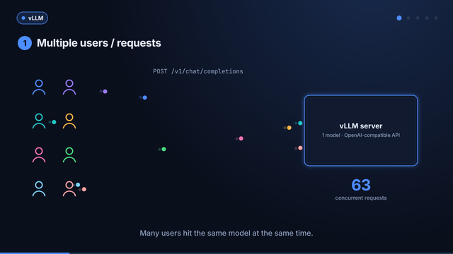
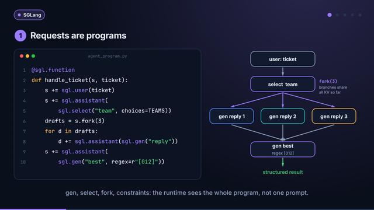
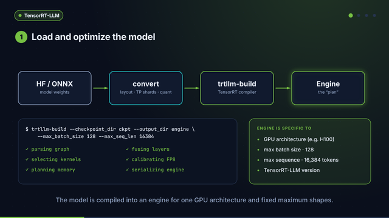
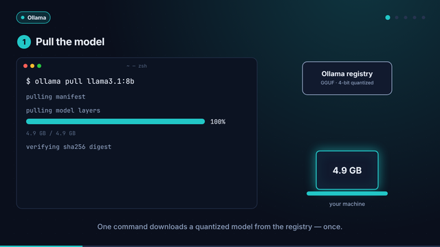

# vLLM, SGLang, TensorRT-LLM, or Ollama?

**Which inference engine should you actually choose, and when?** This repo answers that
with runnable code instead of benchmark screenshots:

* a **unified client** that runs the same application on all four engines,
* **GPU-free simulations** of the ideas inside each engine (PagedAttention, continuous
  batching, RadixAttention, speculative decoding, constrained decoding, quantization,
  kernel fusion),
* a **benchmark harness** for measuring engines under *your* workload,
* an explainable **decision framework**, and
* launch scripts, examples and Docker/Kubernetes configs for each engine.

> If you are choosing an inference engine based on benchmarks alone, you are probably
> choosing it the wrong way. The inference layer is not an implementation detail: it
> directly affects throughput, latency, GPU utilization, developer experience, and the
> economics of your AI application.

## Watch it

Five motion-graphics explainers, generated from code in [`videos/`](videos) with every
on-screen number read from this repo's simulations.

[](videos/out/overview.mp4)

| [vLLM](videos/out/vllm.mp4) | [SGLang](videos/out/sglang.mp4) | [TensorRT-LLM](videos/out/tensorrt_llm.mp4) | [Ollama](videos/out/ollama.mp4) |
|---|---|---|---|
| [](videos/out/vllm.mp4) | [](videos/out/sglang.mp4) | [](videos/out/tensorrt_llm.mp4) | [](videos/out/ollama.mp4) |
| batching, PagedAttention | programs, RadixAttention, speculation | compile, fusion, quantization | pull, GPU/CPU split, local API |

Click a poster for the MP4, or open [`videos/index.html`](videos/index.html) to play and
scrub them in the browser. → [how they are made](videos/README.md)

## The decision framework

| | **Ollama** | **vLLM** | **SGLang** | **TensorRT-LLM** |
|---|---|---|---|---|
| In one line | simplest local experience | scalable production serving | programmable and agentic inference | maximum NVIDIA performance |
| Built around | simplicity | continuous batching + PagedAttention | inference programs + RadixAttention | compiled, fused, quantized engines |
| Choose it when | you want the fastest path to local experimentation and production-scale concurrency is not yet your problem | you are building a production API and care about concurrency, throughput and GPU utilization without deep hardware tuning | your application behaves more like an inference program than a model endpoint | every millisecond matters and you will trade simplicity for NVIDIA-specific optimization |
| Best for | local dev, privacy/offline, open models on your machine | high-throughput serving, many concurrent users, OpenAI-compatible API | agents and tool use, branching, structured outputs | lowest latency, best GPU economics at scale |
| Watch out for | not built for high concurrency | more setup than Ollama; serving-focused | steeper learning curve, younger ecosystem | NVIDIA only; build/engine complexity; less flexible |
| Hardware | CPU, NVIDIA, AMD, Apple Silicon | NVIDIA, AMD, TPU and more | NVIDIA, AMD | NVIDIA |
| Deep dive | [docs/ollama.md](docs/ollama.md) | [docs/vllm.md](docs/vllm.md) | [docs/sglang.md](docs/sglang.md) | [docs/tensorrt-llm.md](docs/tensorrt-llm.md) |

**And the part many teams miss: you may not stay with the same engine forever.**

```
Ollama ──────────▶ vLLM ──────────────▶ SGLang ──────────────────▶ TensorRT-LLM
experimenting      real users arrive     workflows get complex      latency / GPU cost critical
```

The model may stay the same, but changing the engine can completely change how that
model performs in production. That is why inference engineering is becoming a discipline
of its own. → [docs/migration-path.md](docs/migration-path.md)

**Shortlisted vLLM and SGLang?** → [docs/vllm-vs-sglang.md](docs/vllm-vs-sglang.md), a
layer-by-layer comparison (runtime, KV cache and prefix reuse, scheduling, programming
model, structured output, speculative decoding, parallelism, ecosystem) with a runnable
simulation and a fair head-to-head benchmark script.

## Quickstart

```bash
pip install -e ".[dev]"        # Python 3.10+; only httpx and numpy at runtime
pytest -q                      # 150+ tests, no GPU needed

ie simulate all                # watch each engine's core idea run
ie recommend --hardware nvidia-datacenter --concurrency 64 --workload agentic
```

With an engine running (any of them):

```bash
make up-ollama                                   # or up-vllm / up-sglang / up-trtllm
ie chat ollama "Why is LLM decoding memory bound?"   # streams + prints TTFT / TPOT
ie bench ollama --concurrency 1 4 8 --requests 32
ENGINE=ollama python examples/migration/app.py   # same app, any engine
```

## What the simulations show

`ie simulate <topic>` - every number below comes from code in
[`src/inference_engines/concepts`](src/inference_engines/concepts), with tests.

| Topic | Engine | Result |
|---|---|---|
| `batching` | vLLM | Same 200 requests and KV memory: continuous batching ≈ **2× throughput** and **~45 ms vs ~12.5 s** mean TTFT over static batching |
| `paged` | vLLM | Contiguous max-length KV reservations use **17%** of memory; 16-token pages use **99%** |
| `radix` | SGLang | Agent sessions sharing a 1.5k-token system prompt prefill **~12× fewer tokens** |
| `prefix` | vLLM vs SGLang | Block-hash vs radix cache barely differ (<1 pt); **cache-aware scheduling** lifts hit rate **18% → 82%** under memory pressure |
| `speculative` | SGLang (+all) | 90% draft agreement → ~4.5 tokens per target pass; output distribution provably unchanged |
| `constrained` | SGLang (+vLLM) | A *random* model still emits schema-valid JSON; jump-forward cuts model calls **93 → 16** |
| `quantization` | TensorRT-LLM | INT8/FP8 halve weight bytes at ~3% error; INT4 ~3.9× smaller, group size controls error |
| `fusion` | TensorRT-LLM | Fused bias+GELU+residual: **4× less HBM traffic**, 96 fewer kernel launches per pass |
| `memory` | all | Llama-3.1-8B: `q4_K_M` on a 16 GB laptop; 55 × 8k-token sequences on an 80 GB GPU; 70B needs FP8 or 2 GPUs |

### Advanced: after you picked an engine

[docs/advanced.md](docs/advanced.md) covers what decides performance in production.

| Topic | Result |
|---|---|
| `interference` | One 32k-token prompt stalls 32 streams for **657 ms**; chunked prefill bounds it to **58 ms**, a separate prefill pool to **17 ms** |
| `routing` | Across 4 replicas, round-robin keeps **16%** of prefix-cache hits; cache-aware routing keeps **68%** with even load |
| `parallelism` | 4 GPUs: TP=4 gives **5.2 ms** per token, 4 replicas give **23% more throughput**; over Ethernet TP is slower than no TP |
| `offload` | Ollama with 19 of 32 layers on the GPU runs at **26%** of full speed: pick a quantization that fits entirely |
| `capacity` | $ per million tokens, GPUs for a peak load, and the payback period of an engine migration |

## How each engine works

Each engine runs the same five steps - **request → schedule → optimize → decode →
stream** - and optimizes a different one. [docs/architecture.md](docs/architecture.md)
walks through the full diagram; in short:

* **vLLM** - many users → *continuous batching* re-forms the batch every step →
  *PagedAttention* stores KV in pages so far more sequences fit → optimized decode →
  low-latency streaming.
* **SGLang** - many users → *program-based requests* (`gen`, `select`, `fork`,
  constraints) → *speculative / parallel decoding* → *optimized runtime* (RadixAttention,
  cache-aware scheduling) → streaming to complex workflows.
* **TensorRT-LLM** - *load and compile* the model into a GPU-specific engine → *kernel
  fusion, layer fusion, FP8/INT8/INT4* → in-flight batching, multi-stream → TensorRT
  kernels → ultra-low-latency responses.
* **Ollama** - one local user → `ollama pull` from the registry → run on CPU, NVIDIA GPU
  or Apple Silicon → simple local generation → text to CLI, API or app.

## Repository layout

```
src/inference_engines/
  config.py            engine profiles (URLs, default models), env overrides
  client.py            one OpenAI-compatible client (sync + async, streaming, TTFT/TPOT)
  decision.py          explainable engine recommendation + migration path
  cli.py               the `ie` command
  engines/             per-engine launch commands and engine-specific APIs
    ollama.py vllm.py sglang.py tensorrt_llm.py
  concepts/            GPU-free models of what happens inside the engines
    kv_cache.py batching.py radix_cache.py prefix_caching.py speculative.py
    constrained.py quantization.py fusion.py memory.py
    prefill_decode.py routing.py parallelism.py offload.py capacity.py   (advanced)
  benchmark/           async load generator, metrics (TTFT/TPOT/goodput), reports
examples/
  ollama/  vllm/  sglang/  tensorrt_llm/   runnable per-engine examples and launch scripts
  compare/vllm_vs_sglang.py                head-to-head on three workload shapes
  migration/app.py                         the same app on all four engines
deploy/
  docker-compose.yml   one profile per engine      k8s/vllm.yaml   production-shaped vLLM
videos/                motion-graphics explainers: scenes (JS canvas), player, renderer,
                       rendered MP4 / GIF / posters in videos/out/
docs/                  architecture, one page per engine, vLLM vs SGLang, advanced topics,
                       decision framework, migration path, benchmarking
```

## Engine endpoints

| Engine | Default URL | Default model | Start |
|---|---|---|---|
| Ollama | `http://localhost:11434/v1` | `llama3.1:8b` | `ollama serve` + `ollama pull llama3.1:8b` |
| vLLM | `http://localhost:8000/v1` | `meta-llama/Llama-3.1-8B-Instruct` | `vllm serve <model>` |
| SGLang | `http://localhost:30000/v1` | `meta-llama/Llama-3.1-8B-Instruct` | `python -m sglang.launch_server --model-path <model>` |
| TensorRT-LLM | `http://localhost:8001/v1` | `meta-llama/Llama-3.1-8B-Instruct` | `trtllm-serve <model> --port 8001` |

Override with `IE_<ENGINE>_BASE_URL`, `IE_<ENGINE>_MODEL`, `IE_<ENGINE>_API_KEY`
(e.g. `IE_TENSORRT_LLM_BASE_URL`). `ie launch <engine>` prints a tuned launch command.

## Further reading

* [Advanced topics](docs/advanced.md) - chunked prefill, routing, parallelism, offload, cost
* [Benchmarking engines properly](docs/benchmarking.md) - TTFT, TPOT, goodput, sweeps
* [Decision framework](docs/decision-framework.md) - five questions and the scoring model
* Kwon et al., *Efficient Memory Management for LLM Serving with PagedAttention* (2023)
* Zheng et al., *SGLang: Efficient Execution of Structured Language Model Programs* (2024)
* Leviathan et al., *Fast Inference from Transformers via Speculative Decoding* (2023)

## License

MIT - by Thanh & Claude.
